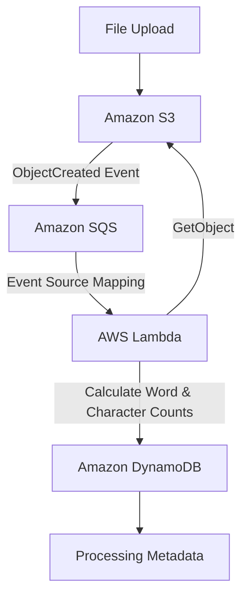

# Event-Driven File Processing Pipeline

A serverless, event-driven file processing pipeline built using AWS services and locally simulated with [Floci](https://github.com/ floci). The project demonstrates asynchronous event processing, object storage, message queuing, serverless compute, and metadata persistence.

## Architecture



## Tech Stack

- **Amazon S3** – Stores uploaded files and generates object-created notifications.
- **Amazon SQS** – Queues file-processing events.
- **AWS Lambda** – Processes files asynchronously using Python.
- **Amazon DynamoDB** – Stores file metadata and processing results.
- **AWS IAM** – Defines Lambda trust and service permissions.
- **Docker Compose** – Runs the local infrastructure environment.
- **Floci** – Provides local AWS service emulation.
- **AWS CLI** – Creates, configures, and verifies resources.

## Workflow

1. A file is uploaded to the S3 bucket.
2. S3 generates an object-created notification.
3. The notification is delivered to the SQS queue.
4. Lambda receives the queued event through an event source mapping.
5. Lambda retrieves the uploaded file from S3.
6. The function calculates the word count and character count.
7. Processing metadata is stored in DynamoDB.

## Project Structure

```text
floci-aws-infra/
├── compose.yaml
├── .gitignore
├── README.md
├── lambda/
│   ├── processor.py
│   ├── trust-policy.json
│   ├── permissions-policy.json
│   ├── queue-policy.json
│   ├── queue-attributes.json
│   └── notification.json
└── samples/
    └── sample.txt
```

## Prerequisites

- Kali Linux or another Debian-based Linux environment
- Docker
- Docker Compose
- AWS CLI
- Python 3
- Floci

## Running Locally

### 1. Start the infrastructure

```bash
docker compose up -d
```

### 2. Configure local AWS CLI credentials

```bash
export AWS_ACCESS_KEY_ID=test
export AWS_SECRET_ACCESS_KEY=test
export AWS_DEFAULT_REGION=us-east-1
export AWS_EC2_METADATA_DISABLED=true
```

These are dummy credentials for local emulation, not real AWS credentials.

### 3. Verify the local environment

```bash
aws s3 ls --endpoint-url=http://localhost:4566
```

### 4. Upload a sample file

```bash
aws s3 cp samples/sample.txt s3://floci-file-processing/sample.txt \
  --endpoint-url=http://localhost:4566
```

The configured event-driven pipeline should process the uploaded file automatically.

### 5. Verify processing results

```bash
aws dynamodb get-item \
  --table-name FileProcessingMetadata \
  --key '{"file_id":{"S":"floci-file-processing/sample.txt"}}' \
  --endpoint-url=http://localhost:4566
```

A successfully processed file should have a `COMPLETED` status along with its word count, character count, and processing timestamp.

## Verification

The automatic end-to-end workflow was tested locally:

**S3 upload → S3 notification → SQS → Lambda → S3 GetObject → DynamoDB**

A test file was uploaded without manually sending an SQS message. Its processing metadata was successfully retrieved from DynamoDB.

## Scope and Limitations

- This project runs locally using Floci; it is not a deployment to real AWS infrastructure.
- The current implementation focuses on basic text-file processing.
- Production-grade retry handling, dead-letter queues, idempotency, and monitoring are potential future improvements.

## Future Improvements

- Implement idempotent processing.
- Add a dead-letter queue for failed messages.
- Improve error handling and input validation.
- Add structured logging and processing metrics.
- Deploy and test the architecture in a real AWS environment.

## Learning Outcomes

This project explores:

- Event-driven cloud architecture.
- Asynchronous messaging and event source mappings.
- Serverless computing.
- Object storage and metadata persistence.
- IAM trust relationships and permissions.
- Docker-based local cloud development.
